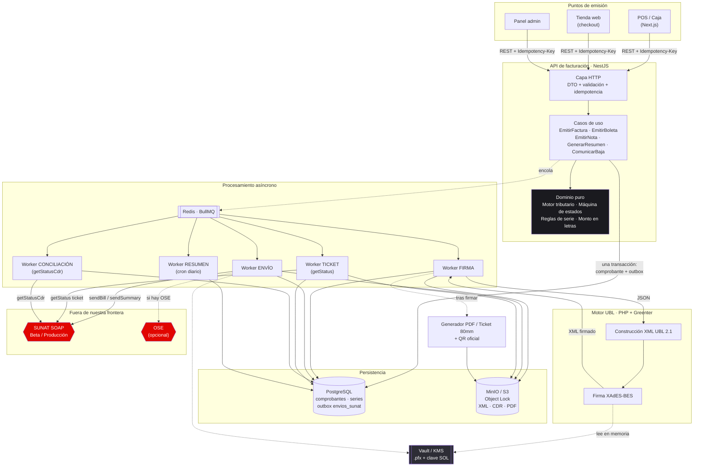
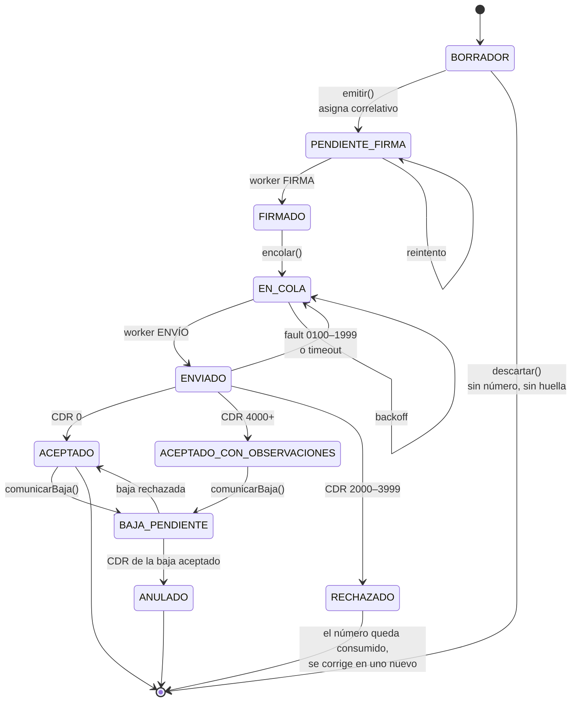

# Arquitectura · Facturación electrónica SUNAT (UBL 2.1)

Plano arquitectónico del sistema de emisión de **Facturas (01)**, **Boletas (03)**, **Notas de
crédito (07)**, **Notas de débito (08)**, **Resúmenes diarios (RC)** y **Comunicaciones de baja
(RA)** para GAUDI.

Este documento no lleva código de aplicación: define componentes, esquema de datos, estados,
concurrencia y contratos. Es el acuerdo previo a escribir la primera línea.

> **Sobre las referencias normativas.** Los plazos, catálogos y códigos citados corresponden a la
> normativa vigente al redactarse este documento (noviembre de 2026) y SUNAT los modifica por
> resolución. Antes de construir, cada plazo marcado con ⚠️ debe confirmarse contra la resolución
> vigente. La arquitectura está pensada para que esos valores sean configuración, no constantes
> esparcidas por el código.

---

## 0. Decisiones de stack, y por qué

El encargo dejaba dos casillas abiertas. Las resuelvo aquí con su justificación, para que se puedan
discutir antes de que cuesten caro.

| Pieza | Elección | Por qué |
|---|---|---|
| API / núcleo | **NestJS + TypeScript** | La tienda ya es TypeScript. Compartir tipos (`Product`, `Order`) entre tienda y facturación evita una capa entera de traducción, y los módulos con inyección de dependencias de Nest calzan con la arquitectura hexagonal sin pelearse. |
| Motor UBL + firma | **Microservicio PHP 8.2 con Greenter** | Decisión incómoda y, aun así, la correcta. Ver abajo. |
| Base de datos | **PostgreSQL 16** | `NUMERIC` exacto, `SELECT … FOR UPDATE` para los correlativos, `jsonb` para los snapshots. |
| Cola | **Redis 7 + BullMQ** (workers en TypeScript) | Reintentos con backoff, trabajos programados y repetibles. |
| Almacenamiento | **MinIO** (S3 compatible) con Object Lock | Misma API en desarrollo y producción; la inmutabilidad la da el almacén, no la disciplina del equipo. |
| Infraestructura | **Docker Compose** | Un `up` levanta todo, incluido SUNAT Beta. |

### Por qué un microservicio PHP en un proyecto TypeScript

Es la decisión que más pesa en este plano y conviene defenderla o descartarla ahora.

Lo que SUNAT rechaza no es el XML "casi bien": es el XML que no coincide **byte a byte** con lo que
espera su validador. La firma **XAdES-BES** va dentro de `ext:UBLExtensions`, se calcula sobre el
documento canonicalizado, y cualquier diferencia en la canonicalización —un espacio, el orden de un
atributo, un prefijo de namespace— produce un error `2335` que no dice nada útil. A eso se suman los
catálogos del Anexo 8, que cambian por resolución.

**Greenter** lleva años resolviendo exactamente eso para el mercado peruano, con los catálogos
dentro y las rarezas del validador ya absorbidas. Escribir XAdES-BES desde cero en Node son semanas
de trabajo y un pasivo permanente: cada cambio de SUNAT vuelve a ser problema nuestro.

El costo es un segundo runtime. Se acota así: el servicio PHP es **sin estado, de un solo
propósito y sin acceso a la base de datos**. Recibe un JSON, devuelve XML firmado. No sabe de
pedidos, ni de clientes, ni de correlativos. Es una función pura metida en un contenedor, y se puede
reemplazar sin tocar nada más.

> **Alternativa, si se prefiere un solo lenguaje:** `xadesjs` + `xmldsigjs` sobre plantillas UBL
> propias. Es viable y elimina el runtime extra. Presupuestar entre 3 y 5 semanas solo para llegar a
> la paridad de firma, más el mantenimiento de los catálogos. Recomiendo no hacerlo en la primera
> versión: cámbiese después, cuando el sistema ya facture y el puerto `FirmadorUBL` tenga una
> implementación de referencia contra la cual comparar.

---

## 1. Diagrama de arquitectura de componentes



### Las tres fronteras que importan

**La caja nunca espera a SUNAT.** `POST /facturas` escribe el comprobante y su fila de outbox en una
sola transacción, encola, y responde. La venta está cerrada en milisegundos. Todo lo que pueda
fallar fuera de nuestra red —firma, envío, CDR— ocurre después. Si SUNAT está caído a las 11 de la
mañana de un sábado, la tienda sigue vendiendo.

**El motor de firma no sabe de negocio.** Recibe un JSON con el comprobante ya calculado y devuelve
XML firmado. No consulta la base de datos ni decide nada. Eso lo hace reemplazable, testeable contra
XML de referencia, y escalable aparte.

**El dominio no sabe de infraestructura.** El motor tributario, la máquina de estados y las reglas
de serie no importan Postgres, ni Redis, ni Greenter: dependen de puertos (interfaces). Son las
piezas donde un error cuesta multas, y son las únicas que se pueden testear sin levantar nada.

---

## 2. Modelo entidad-relación (DDL PostgreSQL)

> Reglas transversales: todo importe es `NUMERIC`, jamás `float` —un centavo de deriva binaria es un
> comprobante observado—. Todo identificador es `uuid`. El esquema se llama `facturacion` para que
> nunca se mezcle con las tablas de la tienda.

```sql
create schema if not exists facturacion;
set search_path to facturacion, public;
create extension if not exists pgcrypto;
```

### 2.1 Emisor, sucursales y certificados

```sql
create table empresas (
  id                 uuid primary key default gen_random_uuid(),
  ruc                char(11) not null unique check (ruc ~ '^(10|15|17|20)[0-9]{9}$'),
  razon_social       text not null,
  nombre_comercial   text,
  domicilio_fiscal   text not null,
  ubigeo             char(6) not null,
  urbanizacion       text,
  distrito           text not null,
  provincia          text not null,
  departamento       text not null,
  usuario_sol        text not null,
  clave_sol_cifrada  bytea not null,
  modo               text not null default 'BETA'
                     check (modo in ('BETA','PRODUCCION')),
  ose_activo         boolean not null default false,
  ose_endpoint       text,
  creado_en          timestamptz not null default now(),
  constraint ose_con_endpoint check (not ose_activo or ose_endpoint is not null)
);

create table sucursales (
  id          uuid primary key default gen_random_uuid(),
  empresa_id  uuid not null references empresas(id),
  codigo      text not null,              -- código de establecimiento anexo ante SUNAT
  nombre      text not null,
  direccion   text not null,
  ubigeo      char(6) not null,
  constraint sucursal_unica unique (empresa_id, codigo)
);

create table certificados (
  id             uuid primary key default gen_random_uuid(),
  empresa_id     uuid not null references empresas(id),
  alias          text not null,
  pfx_cifrado    bytea not null,          -- cifrado con la llave maestra del KMS
  clave_cifrada  bytea not null,
  emisor         text not null,
  numero_serie   text not null,
  valido_desde   timestamptz not null,
  valido_hasta   timestamptz not null,
  activo         boolean not null default false,
  creado_en      timestamptz not null default now()
);

-- Un solo certificado activo por empresa. Dos activos es un fallo silencioso:
-- la mitad de los comprobantes se firma con el que caducó.
create unique index certificados_un_activo
  on certificados (empresa_id) where activo;
```

> **El certificado es la bomba de relojería del sistema.** Vence, y cuando vence no falla "un poco":
> deja de emitirse absolutamente todo. El worker de conciliación debe alertar a los **60, 30 y 7
> días** de `valido_hasta`. Es la alerta más barata de poner y la más cara de no tener.

### 2.2 Series y correlativos

```sql
create table series (
  id              uuid primary key default gen_random_uuid(),
  empresa_id      uuid not null references empresas(id),
  sucursal_id     uuid references sucursales(id),
  caja            text,                   -- 'CAJA-01': una serie por caja (ver §4)
  tipo_documento  char(2) not null check (tipo_documento in ('01','03','07','08')),
  serie           char(4) not null,
  correlativo     integer not null default 0 check (correlativo >= 0),
  activa          boolean not null default true,
  constraint serie_unica unique (empresa_id, tipo_documento, serie),

  -- La letra inicial no es cosmética: SUNAT la valida. Las notas heredan la
  -- letra del documento que modifican (F… si afecta factura, B… si boleta).
  constraint serie_prefijo check (
    (tipo_documento = '01'            and serie ~ '^F[0-9A-Z]{3}$') or
    (tipo_documento = '03'            and serie ~ '^B[0-9A-Z]{3}$') or
    (tipo_documento in ('07','08')    and serie ~ '^[FB][0-9A-Z]{3}$')
  )
);
```

### 2.3 Clientes

```sql
create table clientes (
  id            uuid primary key default gen_random_uuid(),
  empresa_id    uuid not null references empresas(id),
  tipo_doc      char(1) not null check (tipo_doc in ('0','1','4','6','7','A')), -- cat. 06
  numero_doc    text not null,
  razon_social  text not null,
  direccion     text,
  email         text,
  telefono      text,
  creado_en     timestamptz not null default now(),
  constraint cliente_unico unique (empresa_id, tipo_doc, numero_doc),
  constraint cliente_ruc check (tipo_doc <> '6' or numero_doc ~ '^[0-9]{11}$'),
  constraint cliente_dni check (tipo_doc <> '1' or numero_doc ~ '^[0-9]{8}$')
);
```

### 2.4 Comprobantes

```sql
create type estado_comprobante as enum (
  'BORRADOR',
  'PENDIENTE_FIRMA',
  'FIRMADO',
  'EN_COLA',
  'ENVIADO',
  'ACEPTADO',
  'ACEPTADO_CON_OBSERVACIONES',
  'RECHAZADO',
  'BAJA_PENDIENTE',
  'ANULADO'
);

create table comprobantes (
  id                 uuid primary key default gen_random_uuid(),
  empresa_id         uuid not null references empresas(id),
  sucursal_id        uuid references sucursales(id),
  serie_id           uuid not null references series(id),

  tipo_documento     char(2) not null,
  serie              char(4) not null,
  correlativo        integer not null check (correlativo > 0),
  -- "F001-00000123": la forma en que lo nombran SUNAT, el cliente y el contador.
  numero_completo    text generated always as
                     (serie || '-' || lpad(correlativo::text, 8, '0')) stored,

  fecha_emision      date not null,
  hora_emision       time not null,
  fecha_vencimiento  date,
  moneda             char(3) not null default 'PEN',
  tipo_operacion     char(4) not null default '0101',   -- cat. 51

  cliente_id         uuid not null references clientes(id),
  -- Copia congelada del cliente al momento de emitir. Si mañana corrige su
  -- dirección, el comprobante ya emitido NO puede cambiar: lo que se declaró
  -- es lo que se declaró.
  cliente_snapshot   jsonb not null,

  total_gravadas     numeric(14,2) not null default 0,
  total_exoneradas   numeric(14,2) not null default 0,
  total_inafectas    numeric(14,2) not null default 0,
  total_gratuitas    numeric(14,2) not null default 0,
  total_exportacion  numeric(14,2) not null default 0,
  total_descuentos   numeric(14,2) not null default 0,
  total_igv          numeric(14,2) not null default 0,
  total_isc          numeric(14,2) not null default 0,
  total_icbper       numeric(14,2) not null default 0,
  total_otros_cargos numeric(14,2) not null default 0,
  importe_total      numeric(14,2) not null check (importe_total >= 0),
  monto_en_letras    text not null,

  forma_pago         text not null default 'Contado'
                     check (forma_pago in ('Contado','Credito')),
  monto_pendiente    numeric(14,2),

  motivo_nota_codigo    char(2),        -- cat. 09 (NC) / cat. 10 (ND)
  motivo_nota_sustento  text,

  estado             estado_comprobante not null default 'BORRADOR',

  xml_firmado_uri    text,
  xml_hash_sha256    char(64),
  digest_value       text,              -- ds:DigestValue: obligatorio en la impresión
  cdr_uri            text,
  pdf_uri            text,
  qr_texto           text,

  sunat_codigo       text,
  sunat_descripcion  text,
  sunat_notas        jsonb,             -- observaciones (códigos 4000+)
  ticket             text,              -- solo RC/RA
  enviado_en         timestamptz,
  resuelto_en        timestamptz,

  pedido_id          uuid,              -- enlace opcional al pedido de la tienda
  creado_en          timestamptz not null default now(),
  actualizado_en     timestamptz not null default now(),

  constraint comprobante_unico
    unique (empresa_id, tipo_documento, serie, correlativo),

  constraint nota_con_motivo check (
    tipo_documento not in ('07','08') or motivo_nota_codigo is not null
  ),
  constraint credito_con_monto check (
    forma_pago <> 'Credito' or monto_pendiente is not null
  ),

  -- La regla de los S/ 700, en la base de datos y no solo en el código:
  -- sobrevive a cualquier bug de la capa de aplicación.
  constraint boleta_sobre_700_identificada check (
    tipo_documento <> '03'
    or importe_total <= 700
    or ((cliente_snapshot->>'tipo_doc') in ('1','4','6','7','A')
        and length(coalesce(cliente_snapshot->>'razon_social','')) > 0)
  )
);

create index comprobantes_por_estado on comprobantes (empresa_id, estado);
create index comprobantes_del_dia    on comprobantes (empresa_id, fecha_emision);
create index comprobantes_pedido     on comprobantes (pedido_id) where pedido_id is not null;
```

### 2.5 Detalle, cuotas y documentos relacionados

```sql
create table comprobante_items (
  id               uuid primary key default gen_random_uuid(),
  comprobante_id   uuid not null references comprobantes(id) on delete cascade,
  numero_orden     integer not null,
  codigo_producto  text,
  codigo_sunat     text,                              -- cat. 25 (UNSPSC), opcional
  descripcion      text not null,
  unidad_medida    char(3) not null default 'NIU',    -- cat. 03

  cantidad         numeric(12,3) not null check (cantidad > 0),

  -- 10 decimales a propósito. El valor sin IGV de un precio de góndola casi
  -- nunca es exacto a 2 decimales: S/ 32.90 / 1.18 = 27.8813559322…
  -- Redondear aquí produce diferencias de centavos en el total, y ese centavo
  -- es exactamente lo que SUNAT observa.
  valor_unitario   numeric(18,10) not null check (valor_unitario >= 0),
  precio_unitario  numeric(18,10) not null,           -- con IGV, informativo

  descuento_monto  numeric(14,2) not null default 0,
  valor_venta      numeric(14,2) not null,            -- cant.*v.unit - descuento

  tipo_afectacion  char(2) not null,                  -- cat. 07
  igv_base         numeric(14,2) not null default 0,
  igv_monto        numeric(14,2) not null default 0,
  igv_porcentaje   numeric(5,2)  not null default 18.00,
  isc_monto        numeric(14,2) not null default 0,

  icbper_cantidad  integer       not null default 0,
  icbper_factor    numeric(6,2)  not null default 0,  -- S/ por bolsa, por año
  icbper_monto     numeric(14,2) not null default 0,

  total_item       numeric(14,2) not null,
  constraint item_orden_unico unique (comprobante_id, numero_orden)
);

create table comprobante_cuotas (
  id              uuid primary key default gen_random_uuid(),
  comprobante_id  uuid not null references comprobantes(id) on delete cascade,
  numero          integer not null check (numero between 1 and 999),
  monto           numeric(14,2) not null check (monto > 0),
  fecha_vence     date not null,
  constraint cuota_unica unique (comprobante_id, numero)
);

-- La suma de cuotas debe igualar el monto pendiente. Diferido al commit para
-- poder insertar las cuotas una por una dentro de la misma transacción.
create or replace function fn_valida_cuotas() returns trigger as $$
declare v_pendiente numeric(14,2); v_suma numeric(14,2);
begin
  select monto_pendiente into v_pendiente
    from comprobantes where id = new.comprobante_id;
  if v_pendiente is null then return new; end if;
  select coalesce(sum(monto),0) into v_suma
    from comprobante_cuotas where comprobante_id = new.comprobante_id;
  if v_suma <> v_pendiente then
    raise exception 'Las cuotas suman % y el monto pendiente es %', v_suma, v_pendiente;
  end if;
  return new;
end $$ language plpgsql;

create constraint trigger tg_valida_cuotas
  after insert or update on comprobante_cuotas
  deferrable initially deferred
  for each row execute function fn_valida_cuotas();

-- Documento que la nota modifica (y guías, anticipos, etc.)
create table comprobantes_relacionados (
  id              uuid primary key default gen_random_uuid(),
  comprobante_id  uuid not null references comprobantes(id) on delete cascade,
  tipo_documento  char(2) not null,
  serie           char(4) not null,
  correlativo     integer not null,
  -- Enlace fuerte si el documento afectado también vive aquí. Puede ser nulo:
  -- una nota puede modificar un comprobante emitido antes de este sistema.
  afectado_id     uuid references comprobantes(id),
  constraint relacionado_unico
    unique (comprobante_id, tipo_documento, serie, correlativo)
);
```

### 2.6 Resúmenes diarios y comunicaciones de baja

```sql
create type tipo_resumen   as enum ('RC','RA');
create type estado_resumen as enum (
  'BORRADOR','FIRMADO','EN_COLA','TICKET_PENDIENTE',
  'ACEPTADO','ACEPTADO_CON_OBSERVACIONES','RECHAZADO'
);

create table resumenes (
  id                uuid primary key default gen_random_uuid(),
  empresa_id        uuid not null references empresas(id),
  tipo              tipo_resumen not null,
  identificador     text not null,          -- RC-20261127-1 / RA-20261127-1
  fecha_generacion  date not null,          -- fecha en que se envía
  fecha_referencia  date not null,          -- día de los documentos incluidos
  correlativo_dia   integer not null,       -- 1, 2, 3… del mismo día
  estado            estado_resumen not null default 'BORRADOR',
  ticket            text,
  xml_firmado_uri   text,
  cdr_uri           text,
  sunat_codigo      text,
  sunat_descripcion text,
  creado_en         timestamptz not null default now(),
  constraint resumen_unico unique (empresa_id, tipo, identificador)
);

create table resumen_items (
  id              uuid primary key default gen_random_uuid(),
  resumen_id      uuid not null references resumenes(id) on delete cascade,
  comprobante_id  uuid not null references comprobantes(id),
  -- 1 adicionar · 2 modificar · 3 anular
  condicion       smallint not null check (condicion in (1,2,3)),
  constraint resumen_item_unico unique (resumen_id, comprobante_id)
);
```

> **Boletas y facturas no se anulan igual.** Las facturas y notas se dan de baja con una
> **comunicación de baja (RA)**. Las boletas **no**: se anulan informándolas en el **resumen diario
> con condición 3**, o emitiendo una nota de crédito. Meter ambas en el mismo flujo es uno de los
> errores más comunes y produce rechazos que cuesta entender.

### 2.7 Outbox de envíos y bitácora

```sql
create type estado_envio as enum ('PENDIENTE','EN_PROCESO','EXITO','FALLIDO','AGOTADO');

create table envios_sunat (
  id                  bigserial primary key,
  empresa_id          uuid not null references empresas(id),
  comprobante_id      uuid references comprobantes(id),
  resumen_id          uuid references resumenes(id),
  operacion           text not null check (operacion in
                      ('sendBill','sendSummary','getStatus','getStatusCdr')),
  estado              estado_envio not null default 'PENDIENTE',
  intentos            integer not null default 0,
  max_intentos        integer not null default 12,
  proximo_intento     timestamptz not null default now(),
  ultimo_error        text,
  ultimo_error_codigo text,
  request_uri         text,          -- el .zip enviado, tal cual se envió
  response_uri        text,          -- CDR o SOAP Fault, tal cual llegó
  creado_en           timestamptz not null default now(),
  actualizado_en      timestamptz not null default now(),
  constraint envio_un_objeto check (num_nonnulls(comprobante_id, resumen_id) = 1)
);

-- Índice parcial: el worker solo mira lo que está pendiente, no la historia entera.
create index envios_por_despachar on envios_sunat (proximo_intento)
  where estado in ('PENDIENTE','FALLIDO');

create table comprobante_eventos (
  id               bigserial primary key,
  comprobante_id   uuid not null references comprobantes(id),
  estado_anterior  estado_comprobante,
  estado_nuevo     estado_comprobante not null,
  actor            text not null,     -- 'usuario:uuid' | 'sistema:worker-envio'
  detalle          jsonb,
  ocurrido_en      timestamptz not null default now()
);
create index eventos_por_comprobante
  on comprobante_eventos (comprobante_id, ocurrido_en desc);
```

### 2.8 Inmutabilidad en la base

Un comprobante aceptado es un hecho declarado ante la administración tributaria. No se edita.

```sql
create or replace function fn_comprobante_inmutable() returns trigger as $$
begin
  if old.estado in ('ACEPTADO','ACEPTADO_CON_OBSERVACIONES','RECHAZADO','ANULADO') then
    -- Tras un estado terminal solo puede moverse el estado (p. ej. ACEPTADO -> ANULADO
    -- al aceptarse la baja) y los artefactos que llegan después, como el PDF.
    if (new.importe_total, new.correlativo, new.serie, new.cliente_snapshot,
        new.fecha_emision, new.xml_hash_sha256)
       is distinct from
       (old.importe_total, old.correlativo, old.serie, old.cliente_snapshot,
        old.fecha_emision, old.xml_hash_sha256) then
      raise exception
        'El comprobante % está en estado % y no admite cambios de fondo',
        old.numero_completo, old.estado;
    end if;
  end if;
  new.actualizado_en := now();
  return new;
end $$ language plpgsql;

create trigger tg_comprobante_inmutable
  before update on comprobantes
  for each row execute function fn_comprobante_inmutable();
```

En el almacén, lo mismo por otra vía: bucket con **Object Lock en modo COMPLIANCE** y retención de 5
años ⚠️. En modo compliance ni el administrador de la cuenta puede borrar antes de tiempo, que es
justamente el punto. El `xml_hash_sha256` en la base permite demostrar que el archivo recuperado
años después es el mismo que se firmó.

---

## 3. Máquina de estados del comprobante



### Tres estados que el encargo no pedía, y por qué los añadí

**`PENDIENTE_FIRMA`.** El encargo iba de `BORRADOR` directo a `FIRMADO`, lo que obliga a firmar de
forma síncrona dentro de la venta. Si el motor de firma está caído, la caja se bloquea. Separarlo
permite **asignar el correlativo y cerrar la venta sin haber firmado todavía**: el número queda
comprometido en la base, el ticket se imprime en cuanto la firma llega, y la tienda nunca deja de
vender. Es la diferencia entre un sistema de demostración y uno de producción.

**`ENVIADO`.** Sin él no se distingue "esperando turno en la cola" de "ya salió hacia SUNAT y no
sabemos qué pasó". Esa distinción es exactamente la que decide si se puede reenviar o si hay que
consultar `getStatusCdr` primero. Reenviar a ciegas un documento que sí llegó produce el error
`1033`, y a partir de ahí la conciliación se hace a mano.

**`BAJA_PENDIENTE`.** La baja también es asíncrona —se envía un RA, se recibe un ticket, se consulta
después—. Pasar de `ACEPTADO` a `ANULADO` de un salto sería declarar anulado algo que SUNAT todavía
no aceptó anular.

### Qué se permite en cada estado

| Estado | Editar | ¿Tiene número? | Emitir NC/ND | Dar de baja | Reenviar | Imprimir |
|---|---|---|---|---|---|---|
| `BORRADOR` | ✅ | ❌ | ❌ | ❌ | ❌ | solo proforma |
| `PENDIENTE_FIRMA` | ❌ | ✅ | ❌ | ❌ | ❌ | ❌ |
| `FIRMADO` | ❌ | ✅ | ❌ | ❌ | ❌ | ✅ |
| `EN_COLA` | ❌ | ✅ | ❌ | ❌ | automático | ✅ |
| `ENVIADO` | ❌ | ✅ | ❌ | ❌ | solo tras `getStatusCdr` | ✅ |
| `ACEPTADO` | ❌ | ✅ | ✅ | ✅ | ❌ | ✅ |
| `ACEPTADO_CON_OBSERVACIONES` | ❌ | ✅ | ✅ | ✅ | ❌ | ✅ |
| `RECHAZADO` | ❌ | ✅ (consumido) | ❌ | ❌ | solo si se corrigió | ❌ |
| `BAJA_PENDIENTE` | ❌ | ✅ | ❌ | ❌ | consulta ticket | ✅ con sello |
| `ANULADO` | ❌ | ✅ | ❌ | ❌ | ❌ | ✅ con sello |

### El punto que más se malentiende

**Un comprobante rechazado no se arregla: se reemplaza.** SUNAT rechazó ese número, y ese número
queda quemado. La corrección se emite como un comprobante nuevo con el siguiente correlativo, y el
rechazado se queda en la base como constancia de lo que pasó. Permitir "editar y reenviar" sobre el
mismo número es la vía más rápida a una inconsistencia que ya no se puede deshacer.

### Interpretación de la respuesta de SUNAT

| Rango | Canal | Significado | Estado resultante |
|---|---|---|---|
| `0` | CDR | Aceptado | `ACEPTADO` |
| `0100`–`1999` | SOAP Fault | Error de envío o de estructura; **reintentable** tras corregir | vuelve a `EN_COLA` |
| `2000`–`3999` | CDR | Error que invalida el comprobante | `RECHAZADO` |
| `4000`+ | CDR | Observación: **el comprobante es válido** | `ACEPTADO_CON_OBSERVACIONES` |

El rango `4000+` merece subrayarse: son documentos **aceptados**. Tratarlos como errores y
reemitirlos duplica la declaración. Se registran en `sunat_notas`, se muestran en el panel para que
alguien los corrija en los datos maestros, y nada más.

---

## 4. Concurrencia y tolerancia a fallos

### 4.1 El problema del correlativo

Dos cajas cobran a la vez. Ambas piden el siguiente número de `F001`. Si ambas leen `122` y ambas
escriben `123`, hay dos facturas con el mismo número: un problema que ya no tiene arreglo limpio.

**Lo que no sirve, y por qué:**

| Opción | Por qué se descarta |
|---|---|
| `SEQUENCE` de PostgreSQL | **No es transaccional.** Un `ROLLBACK` quema el número y deja un salto. SUNAT exige correlatividad sin saltos. |
| Bloqueo optimista (`version`) | Bajo contención degenera en tormenta de reintentos, y un reintento mal cerrado deja huecos. |
| `MAX(correlativo) + 1` | Condición de carrera de manual. No lo arregla ni `SERIALIZABLE` sin reintentos. |
| Un contador en Redis | Redis puede perder escrituras ante una caída. El correlativo no admite "casi siempre". |

**Lo que se usa: bloqueo pesimista de la fila de la serie, dentro de la misma transacción que
persiste el comprobante.**

```sql
begin;

-- Serializa SOLO esta serie. F001 y F002 no se estorban entre sí.
select correlativo from series
 where empresa_id = $1 and tipo_documento = '01' and serie = 'F001'
   for update;

update series set correlativo = correlativo + 1
 where empresa_id = $1 and tipo_documento = '01' and serie = 'F001'
returning correlativo;                      -- -> 123

insert into comprobantes (..., serie, correlativo, estado)
values (..., 'F001', 123, 'PENDIENTE_FIRMA');

insert into envios_sunat (comprobante_id, operacion, estado)
values ($nuevo, 'sendBill', 'PENDIENTE');

commit;
```

Tres propiedades que hay que ver juntas:

1. **El bloqueo dura lo que dura la transacción**, que son milisegundos: dos `INSERT` locales, ni una
   llamada de red. No se firma ni se envía dentro del bloqueo. Por eso aguanta decenas de cajas.
2. **El comprobante y su fila de outbox se escriben juntos o no se escribe ninguno.** No existe el
   estado "cobré pero no quedó nada por enviar".
3. **El número solo avanza si el comprobante se guardó.** `ROLLBACK` deshace ambos. Nunca hay saltos.

**Y además, una serie por caja.** `F001` para caja 1, `F002` para caja 2, `F003` para la tienda web.
SUNAT lo permite y elimina la contención casi por completo: dos cajas distintas jamás tocan la misma
fila. El bloqueo pesimista queda como red de seguridad para el caso de dos terminales compartiendo
serie, no como el camino habitual.

### 4.2 Por qué nunca puede haber un salto

El salto aparece cuando se reserva un número y después se decide no usarlo. Aquí eso es imposible
por construcción: **el número se asigna en la misma transacción que crea la fila**, así que todo
número asignado tiene documento. Si el documento resulta inservible —se equivocó el cliente, se
anuló la venta— no se borra ni se reutiliza el número: se emite la **nota de crédito** o la
**comunicación de baja**. Que es exactamente lo que SUNAT espera que ocurra.

Por eso `BORRADOR` **no tiene correlativo**. Un carrito abandonado no puede quemar un número.

### 4.3 Reintentos: backoff exponencial con jitter

```
intento   1     2     3     4     5     6     7      8      9     10     11      12
espera   10s   30s   90s   5m    15m   30m   1h     2h     4h    8h     12h     24h
```

Con ± 20 % de aleatoriedad. El jitter no es un detalle: sin él, cuando SUNAT vuelve de una caída,
todos los comprobantes en cola reintentan en el mismo instante y lo tumban otra vez.

Doce intentos cubren unas **52 horas**, holgadamente por encima del plazo de 3 días calendario ⚠️
para enviar una factura. Agotados los intentos, el envío pasa a `AGOTADO` y **se alerta a una
persona**: a esas alturas ya no es un problema técnico.

### 4.4 Cuándo NO reintentar

Esta es la regla que separa un reintentador de uno que hace daño.

```
Falla el envío
│
├─ Error de red / timeout / HTTP 5xx / SOAP Fault 0100–1999
│  └─► Reintentable. Pero si el estado es ENVIADO (ya salió de aquí),
│      PRIMERO getStatusCdr(ruc, tipo, serie, numero):
│         ├─ ya está registrado → guardar el CDR, no reenviar
│         └─ no figura           → reenviar
│
├─ CDR 2000–3999  → RECHAZADO. No se reintenta nunca: el error está en los datos.
├─ CDR 4000+      → ACEPTADO_CON_OBSERVACIONES. No se reintenta: ya está aceptado.
└─ Credenciales / certificado vencido
   └─► Pausar TODA la cola de esa empresa y alertar. Reintentar solo quema
       intentos y llena el log de ruido.
```

`getStatusCdr` es la herramienta de reconciliación del sistema. La pregunta "¿se envió de verdad?"
se le hace a SUNAT, no a nuestro log. Un worker la repasa cada hora sobre todo lo que lleve más de
15 minutos en `ENVIADO`.

### 4.5 Modo offline en tienda

Sin internet, el punto de venta sigue trabajando:

1. La API es local; Postgres es local. La emisión no toca la red.
2. El comprobante se firma localmente —el certificado está en el servidor de la tienda, no en SUNAT—
   y **el ticket se imprime completo, con QR válido**. El comprobante ya existe legalmente al
   emitirse; el envío es una obligación posterior, no un requisito para entregarlo.
3. Los envíos se acumulan en `envios_sunat`. Al volver la conexión, los workers drenan la cola.
4. El panel muestra un contador de pendientes y el plazo que les queda. Mientras el corte no supere
   los 3 días ⚠️ para facturas o 7 ⚠️ para el resumen, no hay consecuencia.

Lo único que de verdad no sobrevive a un corte largo es el certificado vencido. De ahí la alerta de
§2.1.

### 4.6 Idempotencia de extremo a extremo

Dos capas, porque el reintento puede nacer en cualquiera de ellas:

- **Hacia afuera:** cabecera `Idempotency-Key` obligatoria en todo POST que emita. La clave se
  guarda con la respuesta; una segunda llamada con la misma clave devuelve la misma respuesta sin
  emitir nada. Sin esto, un POS que reintenta tras un timeout emite dos facturas.
- **Hacia SUNAT:** el nombre del documento (`RUC-TIPO-SERIE-CORRELATIVO`) es la clave natural.
  Combinado con `getStatusCdr`, hace imposible el doble registro.

---

## 5. Estructura de carpetas y contratos REST

### 5.1 Árbol de directorios (hexagonal)

```
facturacion/
├─ docker-compose.yml
├─ .env.ejemplo
├─ migraciones/
│  └─ 0001_esquema_inicial.sql
│
├─ apps/
│  ├─ api/                                   # NestJS · núcleo
│  │  └─ src/
│  │     ├─ dominio/                         # ⬅ CERO dependencias externas
│  │     │  ├─ comprobante/
│  │     │  │  ├─ comprobante.ts             # entidad e invariantes
│  │     │  │  ├─ maquina-estados.ts         # transiciones permitidas (§3)
│  │     │  │  ├─ motor-tributario.ts        # IGV · ICBPER · descuentos · redondeo
│  │     │  │  ├─ monto-en-letras.ts
│  │     │  │  └─ reglas/
│  │     │  │     ├─ boleta-sobre-700.ts
│  │     │  │     ├─ forma-pago-credito.ts
│  │     │  │     └─ serie-de-nota.ts
│  │     │  ├─ serie/
│  │     │  │  └─ politica-correlativo.ts
│  │     │  ├─ catalogos/                    # Anexo 8, versionado
│  │     │  │  ├─ cat-01-tipo-documento.ts
│  │     │  │  ├─ cat-03-unidad-medida.ts
│  │     │  │  ├─ cat-06-tipo-doc-identidad.ts
│  │     │  │  ├─ cat-07-afectacion-igv.ts
│  │     │  │  ├─ cat-09-tipo-nota-credito.ts
│  │     │  │  ├─ cat-10-tipo-nota-debito.ts
│  │     │  │  └─ cat-52-leyendas.ts
│  │     │  └─ puertos/                      # lo que el dominio EXIGE
│  │     │     ├─ repositorio-comprobantes.ts
│  │     │     ├─ asignador-correlativo.ts
│  │     │     ├─ firmador-ubl.ts
│  │     │     ├─ cliente-sunat.ts
│  │     │     ├─ almacen-documentos.ts
│  │     │     └─ boveda-secretos.ts
│  │     │
│  │     ├─ aplicacion/                      # casos de uso, uno por archivo
│  │     │  ├─ emitir-factura.ts
│  │     │  ├─ emitir-boleta.ts
│  │     │  ├─ emitir-nota-credito.ts
│  │     │  ├─ emitir-nota-debito.ts
│  │     │  ├─ generar-resumen-diario.ts
│  │     │  ├─ comunicar-baja.ts
│  │     │  ├─ consultar-ticket.ts
│  │     │  └─ conciliar-con-sunat.ts
│  │     │
│  │     ├─ infraestructura/                 # adaptadores: aquí vive lo sucio
│  │     │  ├─ postgres/
│  │     │  │  ├─ repositorio-comprobantes.pg.ts
│  │     │  │  └─ asignador-correlativo.pg.ts   # SELECT … FOR UPDATE (§4.1)
│  │     │  ├─ redis/cola-bullmq.ts
│  │     │  ├─ almacen/minio.ts
│  │     │  ├─ ubl/cliente-greenter.http.ts     # único punto que habla PHP
│  │     │  ├─ sunat/cliente-soap.ts
│  │     │  ├─ secretos/vault.ts
│  │     │  └─ pdf/generador-a4.ts · generador-ticket80.ts
│  │     │
│  │     └─ entrada/
│  │        ├─ http/
│  │        │  ├─ comprobantes.controller.ts
│  │        │  ├─ resumenes.controller.ts
│  │        │  ├─ series.controller.ts
│  │        │  ├─ dto/
│  │        │  └─ middleware/idempotencia.ts
│  │        └─ workers/
│  │           ├─ worker-firma.ts
│  │           ├─ worker-envio.ts
│  │           ├─ worker-ticket.ts
│  │           ├─ worker-resumen-diario.ts   # cron
│  │           └─ worker-conciliacion.ts     # cron horario
│  │
│  └─ motor-ubl/                             # PHP 8.2 · Greenter · SIN ESTADO
│     ├─ public/index.php
│     └─ src/
│        ├─ Constructor/                     # JSON -> objetos Greenter
│        ├─ Firmador/
│        └─ Plantillas/
│
└─ pruebas/
   ├─ dominio/                               # unitarias, sin infraestructura
   ├─ integracion/                           # Postgres real, SUNAT simulado
   └─ xml-de-referencia/                     # XML aprobados: regresión de firma
```

La regla que sostiene el árbol: **las flechas de dependencia apuntan siempre hacia `dominio/`**.
`dominio/` no importa nada de `infraestructura/`. Si alguna vez hace falta, es que una regla de
negocio se filtró a un adaptador.

`pruebas/xml-de-referencia/` merece una línea: guardar XML que SUNAT ya aceptó y comparar contra
ellos en cada cambio es la única forma barata de notar que una actualización de la librería de firma
rompió algo, **antes** de que lo note SUNAT.

### 5.2 Contratos REST

Todos bajo `/v1`, autenticados con JWT de servicio. Los POST de emisión exigen `Idempotency-Key`.

| Método | Ruta | Qué hace |
|---|---|---|
| `POST` | `/v1/comprobantes/facturas` | Emite factura (01) |
| `POST` | `/v1/comprobantes/boletas` | Emite boleta (03) |
| `POST` | `/v1/comprobantes/notas-credito` | Emite NC (07) |
| `POST` | `/v1/comprobantes/notas-debito` | Emite ND (08) |
| `GET` | `/v1/comprobantes/{id}` | Estado y datos |
| `GET` | `/v1/comprobantes/{id}/xml` · `/cdr` · `/pdf` | Artefactos (URL firmada) |
| `POST` | `/v1/comprobantes/{id}/reintentar` | Reencola manualmente |
| `POST` | `/v1/comprobantes/{id}/conciliar` | Fuerza `getStatusCdr` |
| `POST` | `/v1/bajas` | Comunicación de baja (RA) |
| `POST` | `/v1/resumenes-diarios` | Resumen de boletas (RC) |
| `GET` | `/v1/resumenes/{id}` | Estado y ticket |
| `GET` | `/v1/series` | Series y correlativo actual |

#### `POST /v1/comprobantes/facturas`

```http
POST /v1/comprobantes/facturas
Idempotency-Key: 9f1c3a80-5e21-4b77-9f3e-2c8d4a1b7e05
Content-Type: application/json
```

```json
{
  "serie": "F001",
  "fechaEmision": "2026-11-27",
  "horaEmision": "15:42:10",
  "moneda": "PEN",
  "tipoOperacion": "0101",
  "cliente": {
    "tipoDoc": "6",
    "numeroDoc": "20512345678",
    "razonSocial": "TRANSPORTES DEL SUR S.A.C.",
    "direccion": "Av. Parra 455, Arequipa",
    "email": "contabilidad@transportesdelsur.pe"
  },
  "formaPago": {
    "tipo": "Credito",
    "montoPendiente": "766.60",
    "cuotas": [
      { "numero": 1, "monto": "383.30", "fechaVence": "2026-12-27" },
      { "numero": 2, "monto": "383.30", "fechaVence": "2027-01-27" }
    ]
  },
  "items": [
    {
      "codigoProducto": "LP-FR-02230",
      "descripcion": "Disco de freno ventilado delantero 296 mm",
      "unidadMedida": "NIU",
      "cantidad": "2",
      "valorUnitario": "262.7118644068",
      "tipoAfectacion": "10",
      "descuentoMonto": "0.00"
    },
    {
      "codigoProducto": "LP-FL-00218",
      "descripcion": "Filtro de aceite W 68/3",
      "unidadMedida": "NIU",
      "cantidad": "4",
      "valorUnitario": "27.8813559322",
      "tipoAfectacion": "10",
      "descuentoMonto": "0.00"
    }
  ],
  "descuentoGlobal": { "monto": "0.00", "afectaBase": true },
  "otrosCargos": [
    { "descripcion": "Flete Arequipa metropolitana", "monto": "12.71", "afectaBase": true }
  ],
  "observaciones": "Pedido LP-2026-005218",
  "pedidoId": "a41f…"
}
```

**`201 Created`** — responde en cuanto la transacción confirma, sin esperar a SUNAT:

```json
{
  "id": "0b9e2f14-7c33-4a1d-8f60-1e5b9c2a7d44",
  "numeroCompleto": "F001-00000123",
  "tipoDocumento": "01",
  "estado": "PENDIENTE_FIRMA",
  "fechaEmision": "2026-11-27",
  "totales": {
    "gravadas":     "636.95",
    "exoneradas":     "0.00",
    "inafectas":      "0.00",
    "gratuitas":      "0.00",
    "descuentos":     "0.00",
    "otrosCargos":   "12.71",
    "igv":          "116.94",
    "icbper":         "0.00",
    "importeTotal": "766.60"
  },
  "montoEnLetras": "SETECIENTOS SESENTA Y SEIS CON 60/100 SOLES",
  "enlaces": {
    "self": "/v1/comprobantes/0b9e2f14-…",
    "xml":  null,
    "cdr":  null,
    "pdf":  null
  },
  "sunat": { "codigo": null, "descripcion": null, "observaciones": [] }
}
```

Los enlaces nacen en `null` y se llenan conforme avanzan los workers. El POS imprime en cuanto
`xml` deja de ser nulo, que es cuando existe el `DigestValue` que el QR necesita.

#### `GET /v1/comprobantes/{id}` — ya resuelto

```json
{
  "id": "0b9e2f14-7c33-4a1d-8f60-1e5b9c2a7d44",
  "numeroCompleto": "F001-00000123",
  "estado": "ACEPTADO_CON_OBSERVACIONES",
  "enlaces": {
    "xml": "https://almacen…/20123456789-01-F001-123.xml?X-Amz-Expires=300",
    "cdr": "https://almacen…/R-20123456789-01-F001-123.zip?X-Amz-Expires=300",
    "pdf": "https://almacen…/F001-00000123.pdf?X-Amz-Expires=300"
  },
  "digestValue": "nR8k…=",
  "qrTexto": "20123456789|01|F001|123|116.94|766.60|2026-11-27|6|20512345678|",
  "sunat": {
    "codigo": "0",
    "descripcion": "La Factura numero F001-123, ha sido aceptada",
    "observaciones": [
      { "codigo": "4000", "mensaje": "El dato ingresado en el tipo de documento del receptor no cumple con el formato establecido" }
    ]
  },
  "envio": { "intentos": 1, "enviadoEn": "2026-11-27T15:42:14Z", "resueltoEn": "2026-11-27T15:42:19Z" }
}
```

#### `POST /v1/comprobantes/notas-credito`

```json
{
  "serie": "FC01",
  "fechaEmision": "2026-11-28",
  "tipoNota": "06",
  "sustento": "Devolución total: el disco no corresponde al modelo del vehículo",
  "documentoAfectado": { "tipoDocumento": "01", "serie": "F001", "correlativo": 123 },
  "cliente": { "tipoDoc": "6", "numeroDoc": "20512345678", "razonSocial": "TRANSPORTES DEL SUR S.A.C." },
  "items": [ { "codigoProducto": "LP-FR-02230", "descripcion": "Disco de freno ventilado delantero 296 mm",
               "unidadMedida": "NIU", "cantidad": "2", "valorUnitario": "262.7118644068", "tipoAfectacion": "10" } ]
}
```

La serie se valida contra el documento afectado: una NC sobre factura **debe** ir en serie `F…`.
Mandar `BC01` aquí devuelve `422` antes de tocar la base.

#### `POST /v1/resumenes-diarios`

```json
{ "fechaReferencia": "2026-11-27", "incluirAnulaciones": true }
```

```json
{
  "id": "7c2e…",
  "identificador": "RC-20261128-1",
  "estado": "EN_COLA",
  "fechaReferencia": "2026-11-27",
  "documentos": { "adicionados": 48, "modificados": 0, "anulados": 2 }
}
```

Lo dispara el cron a las 00:30 del día siguiente; el endpoint existe para relanzarlo a mano.

#### Errores

Formato único, `application/problem+json`:

```json
{
  "tipo": "https://gaudi.pe/errores/regla-boleta-700",
  "titulo": "La boleta supera S/ 700 y el cliente no está identificado",
  "estado": 422,
  "detalle": "El importe total es S/ 1,240.00. Sobre S/ 700 se exige DNI o CE y nombre completo del adquirente.",
  "campo": "cliente.numeroDoc"
}
```

| Código | Cuándo |
|---|---|
| `409` | `Idempotency-Key` repetida con cuerpo distinto |
| `422` | Regla de negocio o catálogo inválido (no se creó nada) |
| `423` | Serie bloqueada: certificado vencido o cola en pausa |
| `503` | SUNAT inalcanzable **y** el comprobante requería respuesta síncrona |

---

## 6. Qué toca de GAUDI tal como está hoy

Esto no estaba en el encargo, pero salió al leer el código y callarlo sería caro.

**`src/lib/orders.ts` · `nextOrderNumber()` genera `LP-2026-004872` con `Math.random()`.** Está
bien **siempre que siga siendo un número de pedido y nunca un correlativo**. Son cosas distintas: el
pedido es interno y puede tener saltos; el correlativo es fiscal y no puede. Un pedido se factura en
uno o varios comprobantes, y en la base eso es `comprobantes.pedido_id`.

**Los precios del catálogo incluyen IGV** (`igvIncluded` en `src/lib/format.ts` lo deriva de un
monto bruto). UBL pide el **valor unitario sin IGV**, y la división casi nunca cierra: `32.90 / 1.18
= 27.8813559322…`. De ahí los `numeric(18,10)` de `comprobante_items.valor_unitario`. **Los totales
se calculan sumando las líneas, nunca re-derivando desde el total bruto**; hacerlo al revés produce
diferencias de uno o dos céntimos que SUNAT observa.

**`round2()` usa `Math.round(n * 100) / 100` sobre coma flotante.** Correcto para pintar precios en
pantalla; **no** para el cálculo fiscal. El motor tributario debe trabajar con decimales exactos
(`decimal.js` en Node, `NUMERIC` en Postgres) y no reutilizar esta función.

**El tipo `Order` no tiene desglose tributario**: solo `subtotal`, `discount`, `shipping`, `total`.
Necesita bases por tipo de afectación, IGV y el flete modelado explícitamente —el flete cobrado al
cliente normalmente integra la base gravada, sea como ítem o como `otrosCargos`—.

**`site.ruc` todavía dice `[RUC]`.** Sin RUC, razón social, domicilio fiscal y ubigeo reales no se
puede ni firmar en Beta.

**Y una pregunta que no es técnica, para el contador:** cuando el cliente paga con saldo de la
billetera de cashback, ¿eso es un **descuento** —reduce la base imponible y por tanto el IGV— o un
**medio de pago** —no toca la base—? Las dos lecturas son defendibles y producen XML distintos.
Conviene resolverlo antes de modelarlo, porque cambiarlo después implica rectificar comprobantes ya
declarados.

---

## 7. Orden de construcción sugerido

| # | Hito | Por qué va aquí |
|---|---|---|
| 1 | Esquema + asignador de correlativos + pruebas de concurrencia | Es el cimiento. Un bug aquí no se arregla después. |
| 2 | Motor tributario con casos de prueba del contador | Pura lógica, sin red. Se valida con una hoja de cálculo. |
| 3 | Motor UBL + firma contra **Beta** | Primer contacto con la realidad. Aquí aparecen las sorpresas. |
| 4 | Outbox + workers de firma y envío | Convierte el prototipo en algo que resiste caídas. |
| 5 | Facturas y boletas de punta a punta en Beta | Primer comprobante aceptado. |
| 6 | Resumen diario + comunicación de baja | Cierra el ciclo de las boletas. |
| 7 | Notas de crédito y débito | Dependen de que haya documentos que afectar. |
| 8 | PDF A4 y ticket 80 mm con QR | Lo que ve el cliente; necesita el `DigestValue` del paso 3. |
| 9 | Conciliación, alertas y tablero de pendientes | Lo que permite dormir tranquilo. |
| 10 | Homologación y paso a **Producción** | Con certificado real y RUC real. |

No empezar por el paso 10 ni por el PDF. El orden está puesto para que cada paso se pueda probar de
verdad antes de que el siguiente dependa de él.
